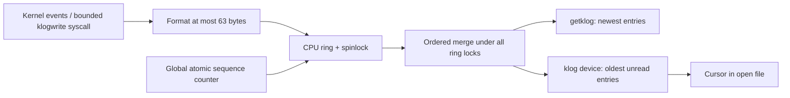
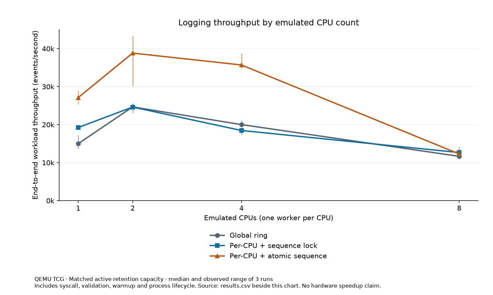

# xv6 Kernel Logging System

A bounded kernel event log with per-CPU rings, ordered snapshots, independent streaming readers, automated correctness tests, and reproducible contention benchmarks.

Built on the x86 version of xv6, this project explores kernel memory safety, multicore synchronization, device interfaces, and performance measurement. It compares a global ring, per-CPU rings with a shared sequence lock, and per-CPU rings with atomic sequence allocation.

**Evidence:** historical sanitizer/guest tests and 72 published benchmark measurements are retained. The final audit adds strict tests for all four modes, sequence exhaustion and inherited readers, CI, and a separate capacity-matched measurement set. See [the audit report](AUDIT.md) for executed checks and remaining limits. [Test evidence](benchmarks/validation.log) · [Measured results](benchmarks/README.md) · [Demo transcript](benchmarks/demo-run.log)

**Documentation:** [Live demo walkthrough](DEMO.md) · [Technical report](PROJECT_REPORT.md) · [Original xv6 documentation](xv6-public/README)

## xv6 fundamentals

xv6 is a small Unix-like teaching OS. This repository targets 32-bit x86, with processes, virtual memory, a filesystem, devices, and an interrupt-based system call interface. Kernel code runs with privileged memory access and a small per-process stack; user programs reach the logger through validated syscalls and file descriptors. QEMU boots the actual kernel rather than a user-space simulation of the logging logic.

## Project origin and contributions

The starting point is [thenithin342/Logging_system_in_xv6](https://github.com/thenithin342/Logging_system_in_xv6) at commit `ee36653`. The inherited commits are attributed to Krishna Chaitanya. This version preserves that history and improves the existing implementation through memory-safety repairs, consistent retrieval, per-open cursors, overwrite accounting, atomic sequence allocation, automated tests, and measured comparisons. The original xv6 OS and initial logging subsystem are inherited work.

## Run it

Use Linux or Ubuntu WSL. Prerequisites: GCC with x86 `-m32` code generation, binutils, make, Perl, Python 3, and QEMU x86. On Ubuntu:

```sh
sudo apt-get update
sudo apt-get install build-essential qemu-system-x86 python3
git clone https://github.com/thenithin342/Logging_system_in_xv6.git
cd Logging_system_in_xv6/xv6-public
make qemu-nox CPUS=4
```

At the xv6 shell:

```text
klog_test
klog_stress
ulog_tool
klog_bench 4 0
klog_bench 4 1
```

Exit QEMU with **Ctrl+A, then X**. `klog_test` creates the read-only `klog` device node in xv6's root directory. Each independent `open("klog", O_RDONLY)` starts at the oldest retained entry. No `/dev` directory is required.

On Windows, open Ubuntu using `wsl -d Ubuntu`, navigate to your checkout under `/mnt/c/...`, and run the same build command. This is an x86 teaching kernel; Windows GCC alone is not the supported build environment.

## What was fixed

| Original problem | Current behavior |
| --- | --- |
| Device reader put 5,632 bytes of entries on a 4,096-byte kernel stack | One allocated page; allocation/copy failures release resources |
| Device reads repeated old entries | A sequence cursor lives in each open file; `dup` and `fork` share it |
| Snapshot cutoff assumed contiguous IDs | Merge actual retained sequences across rings, newest 46 at most |
| Two-pass snapshots raced writers | Lock all rings in CPU order while selecting a consistent view |
| Logging reads generated more logging | Reads of the log device do not emit read events |
| Overwrites were never counted | Each overwritten record increments its ring's counter |
| Unsupported formats could overrun the message | Bound every append; test truncation and `INT_MIN`; zero unused message bytes |
| Sequence IDs could wrap and reset reader progress | Reserve a terminal cursor and reject new events at exhaustion using bounded 32-bit allocation |
| Inherited console/user integer printers negated `INT_MIN` as a signed value | Use unsigned magnitude; test both bodies with sanitizers and verify real guest unsigned output |
| Requests were silently reduced to one page | Reject requests above the shared `KLOG_MAX_ENTRIES` limit (46) |
| Documentation claimed lock-free/nanoseconds/persistence | Ring spinlocks, raw TSC cycles, volatile memory; limitations below |

## Architecture



Each entry is 88 bytes: six 32-bit fields (sequence, TSC high/low, CPU, PID, level) and a 64-byte message. There are 256 records per CPU, statically allocated for `NCPU=8`. Writers disable local interrupts to keep CPU selection stable, format a bounded message, lock their ring, allocate an ID, fill the record, and publish the new head/count before unlocking.

Readers acquire all ring locks in increasing CPU order and release them in reverse order. This gives a point-in-time view of published entries and prevents a lower sequence from appearing after a reader advances past it. Retrieval merges the real sequence IDs rather than inferring contiguous ranges. It costs roughly `O(NCPU * returned_entries)` for snapshots; a stream may also scan skipped retained records. Snapshots block writers briefly, an intentional correctness/performance tradeoff.

`getklog(entries, n)` returns the newest records in increasing sequence order for `1 <= n <= 46`; zero returns zero, invalid counts or destinations return `-1`. The stream returns whole records, at most 46 per call, and returns zero when currently caught up. Reads can resume after later events arrive. An undersized nonzero buffer returns `-1`. Slow readers skip overwritten records; gaps in IDs and `klogdropped()` expose loss. An independent open has its own cursor; duplicated/inherited descriptors share the cursor. xv6's inode sleep lock serializes reads, including independent readers of the same device inode.

`klogdropped()` exposes the unsigned 32-bit overwrite count; its binary syscall return register is unchanged. The viewer uses unsigned sequence output.

The new `klogwrite(level, literal)` syscall validates up to 64 bytes through user page mappings, rejects inaccessible or overlong strings, and treats the text literally. Levels 0–3 emit an event; level `-1` validates the same input without emitting, for the benchmark control. This is an educational OS API available to every process, with no log access control.

## Tests

From the repository root in Linux/WSL:

```sh
python3 tests/run_host.py
python3 tests/run_qemu.py
python3 tests/run_qemu.py --benchmark --repeats 3 --output-dir artifacts/benchmark
python3 benchmarks/summarize.py --input-dir artifacts/benchmark
```

The host suite runs the actual `klog.c` and `klogdev.c` with pthread/memory-copy platform stubs under AddressSanitizer and UndefinedBehaviorSanitizer. It checks integer/formatter boundaries, empty snapshots, gaps, exact overwrite counts, newest-entry selection, independent cursors, concurrent writers, and allocation/copy failure cleanup.

The QEMU suite boots xv6, asserts the requested number of CPUs is detected, runs syscall/device assertions and an 18,000-write stress workload with concurrent readers and snapshots, and fails on missing success markers, a panic, or a timeout. Its default matrix covers modes 0–3 and 1, 2, 4, and 8 CPUs. A benchmark run repeats those checks in all three implementations. QEMU uses temporary disk overlays, so the runner does not change the base filesystem image. Python and QEMU are test tools, not kernel dependencies. Output defaults to ignored `artifacts/qemu/`; the runner refuses to overwrite published historical data or an existing completed benchmark CSV.

## Performance comparison

| Build option | Buffer | Sequence allocation |
| --- | --- | --- |
| `KLOG_MODE=0` | One shared 256-entry ring | Spinlock protected counter |
| `KLOG_MODE=1` | 256 entries per CPU | Shared sequence spinlock |
| `KLOG_MODE=2` (default) | 256 entries per CPU | Bounded 32-bit atomic CAS |

Mode 2 uses compare-and-swap to reserve an ID only while the counter is below its terminal value. It removes acquisition of the shared sequence spinlock. It still has ring spinlocks and a shared cache line for the sequence counter. Mode 0 keeps the same sequence allocator as mode 1 to isolate the change in buffer partitioning. Its retained capacity is smaller; overwrite counts must be interpreted with that difference in mind. `make KLOG_MODE=...` rebuilds the mode-sensitive objects automatically. Mode 3 disables emission at build time and is covered by host and guest correctness tests. It is excluded from the emitting-architecture comparison. `KLOG_GLOBAL_CAPACITY` controls mode 0 retention; the benchmark runner matches it to 256 times the detected guest CPU count.

See [measured results and methodology](benchmarks/README.md), [raw measurements](benchmarks/results.csv), and [test transcripts](benchmarks/validation.log). These are QEMU/WSL measurements, with no claim about native hardware speed or production workloads.



## Historical measurements (before the final audit)

The table below preserves the pre-audit, unequal-capacity comparison. Mode 2 then used unconditional fetch-and-add. These measurements do not describe the final bounded-CAS implementation. Current results and capacity matching are reported [separately](benchmarks/audit-final-2026-10-22/README.md).

Historical median enabled workload throughput from three QEMU runs per configuration:

| Emulated CPUs | Global ring | Per-CPU + sequence lock | Per-CPU + atomic sequence |
| ---: | ---: | ---: | ---: |
| 1 | 24,518 events/s | 22,831 events/s | 26,876 events/s |
| 2 | 30,359 events/s | 28,293 events/s | 42,364 events/s |
| 4 | 29,354 events/s | 29,037 events/s | 24,927 events/s |
| 8 | 9,178 events/s | 8,760 events/s | 10,893 events/s |

Atomic sequencing improves the observed median in some configurations and regresses at four CPUs. All variants slow down at eight emulated CPUs. This is a useful systems result: changing one synchronization mechanism does not guarantee linear scaling or a universal speedup. The [full table](benchmarks/table.md) includes controls, observed ranges, latency, and overwrites. Throughput includes syscall validation, warmup, process lifecycle, and emulator scheduling; it is not isolated kernel insertion throughput.


## CI

[Kernel logging validation](.github/workflows/ci.yml) runs on pushes and pull requests using Ubuntu 24.04. It installs prerequisites, checks historical evidence and Markdown links, runs strict ASan/UBSan tests for modes 0–3 (including an enlarged global ring), performs a clean x86 build, and boots all four modes at 1 and 2 CPUs. Failures fail the job and preserve logs as artifacts. The optional manual `full_benchmark` job runs the repeated capacity-matched 1/2/4/8-CPU comparison and validates its CSV before creating reports. Both third-party actions are pinned to verified commit IDs.

## Future work

A wider sequence/epoch protocol could permit longer uptime; a less intrusive reader algorithm could reduce pauses. Hardware calibration, access policy, persistence, profiling, and a pooled latency distribution require separate requirements and measurements. The [supplementary study guide](AMD_INTERVIEW_GUIDE.md) explains the implemented tradeoffs in more depth.

## Scope and limits

- All records are in RAM and disappear on reboot; a full ring overwrites its oldest record.
- The unchanged 32-bit sequence ABI safely stops after `2^32-2` emitted events. Zero is a failed reservation, `UINT_MAX` is the terminal cursor, and published IDs never wrap. Active `klogwrite` returns `-1` after exhaustion; existing void kernel logging hooks cannot propagate the error. Clear preserves exhaustion, and reboot starts a new volatile epoch.
- Timestamps are raw, uncalibrated `RDTSC` values. Ordering uses sequence IDs, and timestamps must not be interpreted as nanoseconds or assumed synchronized on arbitrary physical CPUs.
- Retrieval allocates one page and returns `-1` if allocation fails. It can copy some bytes before a later invalid destination page fails; on device failure the cursor is not advanced.
- Snapshot locking pauses writers; this is not a lock-free implementation or a production tracing subsystem.
- The benchmark includes syscall, input validation, and timing overhead. Its P95 is the average of workers' sample P95 values, not a pooled P95.

Read [the technical report](PROJECT_REPORT.md), [demo walkthrough](DEMO.md), and the original [xv6 README](xv6-public/README). `Documentation.pdf` is an inherited historical document and does not describe these changes; the current Markdown files and executable tests are authoritative.
