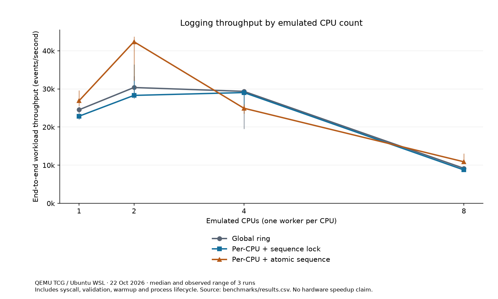

# Historical logging benchmark (pre-audit)

Run date: **22 October 2026**. These measurements come from the actual xv6 guest under QEMU TCG in Ubuntu WSL, rather than from illustrative values. See `environment.json` for versions and source hashes, `results.csv` for every measurement, `summary.csv` for aggregates, and `qemu-mode-*-cpus-*.log` for the guest output. `validation.log` records the full test/benchmark run; `host-tests.log` records the sanitizer suite.

The recorded code predates the final audit: mode 2 used fetch-and-add and mode 0 retained only 256 records. These files remain unchanged. The [current capacity-matched report](audit-final-2026-10-22/README.md) evaluates the audited code separately. The manifest in `historical-manifest.json` protects the original CSVs, plots, environment metadata, and transcripts.

## Reproduce

From the repository root in Linux/WSL:

```sh
# Validate the historical dataset without rewriting it.
python3 benchmarks/summarize.py --check-only
# Measure the current code into a fresh directory.
python3 tests/run_qemu.py --benchmark --capacity-policy matched --output-dir artifacts/benchmark
python3 benchmarks/summarize.py --input-dir artifacts/benchmark
```

Only the optional chart/report generation requires Matplotlib (`sudo apt-get install python3-matplotlib` on Ubuntu). The kernel and the test runner do not. The summarizer requires the full 1/2/4/8-CPU, three-variant matrix and at least three repetitions; it checks for duplicate or missing groups and validates event counts and wall-throughput calculations before generating output.

The runner uses QEMU's `tcg,thread=multi` accelerator, 512 MiB guest RAM, and explicit single-core sockets so xv6's legacy MP discovery sees the requested CPUs. It asserts the guest CPU count, then runs `klog_test` and `klog_stress` before each benchmark configuration. The runner leaves the normal mode-2 kernel/image built at completion. Disk changes occur in QEMU overlays.

## Method

- Mode 0: all CPUs write to one 256-record ring; the shared sequence allocator uses its spinlock.
- Mode 1: each CPU writes to its own 256-record ring, still using the shared sequence spinlock.
- Mode 2: the same per-CPU rings with atomic sequence allocation, removing the sequence spinlock acquisition.
- Each CPU configuration uses an equal number of worker processes, with pipe start tokens, 256 warmup calls per worker, and 16,384 measured workload calls per worker. Workers can migrate; they are not pinned to individual CPUs.
- Each worker samples 128 evenly spaced call durations using `CPUID` and `RDTSC`. Mean sample latency includes syscall entry/exit, bounded user-string validation, logging (when enabled), and serialization overhead. The control calls the same syscall with emission disabled. These are not isolated kernel insertion cycles.
- The reported P95 is the average of each worker's 128-sample P95. It is not the P95 of a pooled distribution. Table values are medians across the three runs.
- Throughput is workload event count divided by Python's monotonic wall duration from command dispatch to the next shell prompt. It includes warmup, shell/process lifecycle, sample sorting, and pipe coordination. Guest tick counts are recorded without converting uncalibrated ticks to seconds.
- Control and emission order alternates across repetitions. The table and chart report observed minimum/maximum and median; three runs give limited evidence about variability.
- Overwrite deltas include warmup and incidental process events. Mode 0 has less retained capacity than the per-CPU modes. These values indicate ring pressure, not reader-specific loss or a directly equal-capacity comparison.

No CPU frequency conversion, emulator-to-hardware extrapolation, or universal speedup is claimed. Host scheduling and the xv6 scheduler can dominate at high emulated CPU counts. Repeated runs share a guest instance, so rings are already under steady overwrite pressure after stress/warmup.

## Results



[Full results table: latency, worker P95, overwrite counts, controls, and run ranges](table.md).

In this run, atomic sequencing had a higher median enabled throughput than the per-CPU sequence-lock version at 1, 2, and 8 CPUs, and a lower median at 4 CPUs. All variants lost throughput at 8 CPUs. The control runs also vary, so this experiment does not isolate a universal benefit from the atomic instruction or establish the cause of the high-CPU slowdown. The results support keeping the comparison reproducible and measuring the intended hardware/workload before choosing an implementation.

## Correctness evidence

The completed run passed all 12 guest configurations (three algorithms times four CPU counts) before collecting 72 benchmark measurements (three repetitions times enabled/control). Every configuration ran the syscall/device assertion suite and the 18,000-write stress workload. The independent host suite passed for all three algorithms under ASan/UBSan, including device allocation and copy failure cleanup. The logging and device sources also compiled with a 1,024-byte maximum stack-frame warning promoted to an error.

The build retains inherited xv6 linker warnings about executable stacks and RWX segments; these tests do not turn this teaching OS into a hardened production kernel. Native hardware performance, a pooled P95 distribution, build-time-disabled mode 3, and forced full-kernel allocator exhaustion were not tested. Allocation failure is injected in the host device test instead.
